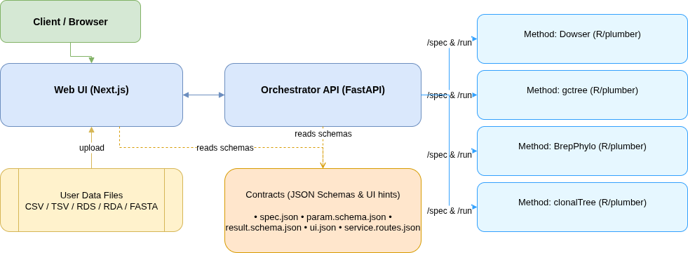

# phylo-framework

A one-page UI to run phylogeny/lineage tree methods behind a simple orchestrator API.

- **Web**: Next.js (apps/web)
- **API**: FastAPI (apps/api)
- **Methods**: pluggable microservices (Dowser, GCtree, BrepPhylo, ClonalTree included)
- **Contracts**: JSON schemas (packages/contracts) used by both UI & API to drive parameters, validation, and results
- **Object storage**: self-hosted **MinIO** (S3-compatible) holds uploaded datasets and generated artifacts; the database stores only metadata + references

> **Heads-up**: Running with Docker for the first time is **time-consuming** because large R images and packages need to be downloaded and built.

> **File management (important):** Uploaded datasets and generated run artifacts
> (images, PDFs, Newick, TSV/CSV, logs, ZIP bundles) live in **MinIO**, never in the
> repository and never as base64 in the database. Downloads/previews are streamed
> through the API. See [File Management & Object Storage](#file-management--object-storage)
> and [docs/DEPLOYMENT.md](./docs/DEPLOYMENT.md). The `.env` file is **gitignored** —
> copy `.env.example` to `.env` before running.

---

## Table of Contents

- [Quick Start](#quick-start)
- [What You Get](#what-you-get)
- [Architecture](#architecture)
- [File Management & Object Storage](#file-management--object-storage)
- [Ports](#ports)
- [Prerequisites](#prerequisites)
  - [macOS](#macos) · [Linux](#linux) · [Windows](#windows)
- [Run It](#run-it)
  - [Dev — Full Docker Compose (simplest)](#dev--full-docker-compose-simplest)
  - [Dev (Docker methods)](#dev-docker-methods)
  - [Dev (Local R methods)](#dev-local-r-methods)
  - [Prod (Docker Compose)](#prod-docker-compose)
- [Manual Run (Developers)](#manual-run-developers)
- [Clean Reset (wipe local DB + storage)](#clean-reset-wipe-local-db--storage)
- [Environment Variables](#environment-variables)
- [Testing and Coverage](#testing-and-coverage)
- [Troubleshooting](#troubleshooting)
- [Extend: Add a New Method](#extend-add-a-new-method)
- [Repository Layout](#repository-layout)
- [License](#license)

---

## Quick Start

1. **Clone with submodules** (required for ClonalTree base code):

```bash
git clone --recurse-submodules <repo-url>
cd phylo-framework
```

If you already cloned without submodules:

```bash
git submodule update --init --recursive
```

2. **Install Node & workspace deps (root)** and **API Python deps**:

```bash
# Node deps (root — installs workspaces too)
npm i

# Python deps for the API
python3 -m venv .venv
source .venv/bin/activate
python -m pip install -U pip
pip install -r apps/api/requirements.txt
```

3. **Create your `.env`** (it is gitignored — never committed):

```bash
cp .env.example .env
# then edit secrets (JWT_SECRET_KEY, MinIO credentials, OAuth/email keys, etc.)
```

4. **Make helper scripts executable** (they are expected at the repo root):

```bash
chmod +x ./run.sh ./scripts/dev-with-docker.sh ./scripts/dev-with-local-r.sh ./scripts/reset-local.sh
```

5. **Run the interactive menu** (uses Inquirer under the hood):

```bash
./run.sh
```

Pick:

- **Dev → Docker** (no local R needed; slower first run)
- **Dev → Local R** (fast if you already have R 4.3+ with packages)
- **Prod → docker compose** (recommended for deployments)

> All modes start **MinIO** automatically and create the `phylo-datasets` /
> `phylo-artifacts` buckets on first run. The scripts perform port checks and
> dependency checks and print **meaningful errors** if something is missing or a
> port is busy.

> Prefer everything in containers? Use the one-command
> [Dev — Full Docker Compose](#dev--full-docker-compose-simplest) flow instead of `./run.sh`.

---

## What You Get

- **UI**: dynamic schema-driven form; upload data (CSV/TSV/RDS/RDA/FASTA for Dowser); display trees/results; lazy artifact downloads + image previews (no base64 in the browser).
- **API** (FastAPI):
  - `GET /methods` — list methods
  - `GET /methods/{id}/spec` — method spec + UI hints
  - `POST /uploads/init` + `PUT /uploads/{id}/content` — upload a dataset to object storage
  - `POST /runs?method={id}` — create a run referencing an uploaded `file_id`
  - `GET /runs/{id}/result` — **lightweight** scientific summary only (no base64, no embedded binaries) + `dataset` descriptor + `artifact_count`
  - `GET /runs/{id}/artifacts` — list downloadable artifact descriptors
  - `GET /artifacts/{id}/download` · `GET /artifacts/{id}/preview` — stream a file / inline preview
  - `GET /datasets/{id}/download` — download the original uploaded dataset
  - `DELETE /datasets/{id}` — hard-delete the stored object, soft-delete the metadata row (idempotent; preserves run history)
- **Method services**: R/plumber (Dowser, BrepPhylo) and FastAPI (GCtree, ClonalTree) exposing `/spec` + the async `/jobs` contract. They write output files + a manifest; the worker uploads those to MinIO. No base64 crosses the service→API boundary.

---

## Architecture



- **Contracts** (packages/contracts/methods/<id>/…)
  - `spec.json`: name, version, accepted MIME types
  - `param.schema.json`: JSON-Schema parameters (drives UI)
  - `result.schema.json`: JSON-Schema results (validated by API)
  - `ui.json`: UI hints (required files, control order, etc.)
  - `service.routes.json`: maps method endpoints (`/spec`, `/run`)

---

## File Management & Object Storage

The system of record for files is **MinIO** (self-hosted, S3-compatible, free). No
AWS or paid cloud storage is required. The abstraction stays S3-compatible, so a
real S3 endpoint can be used later by changing env vars only.

| What | Where | Notes |
| --- | --- | --- |
| Uploaded datasets | MinIO bucket `S3_BUCKET_DATASETS` | key `datasets/{user}/{upload}.{ext}` |
| Generated artifacts | MinIO bucket `S3_BUCKET_ARTIFACTS` | key `artifacts/{run}/{artifact}/{file}` |
| Run/file/artifact metadata | PostgreSQL | lightweight `result` JSON; **no base64** |
| Staging scratch (`/runtime/storage`) | host bind / volume | where a dataset is staged for a method to read |
| Method job outputs (`/runtime/method-jobs`) | host dir / volume | method writes files; the **worker** uploads them to MinIO |

Flow: upload → object in `phylo-datasets`; the worker stages it for the method
service, the method writes output **files + a manifest**, and the worker uploads
those to `phylo-artifacts` and records `run_artifacts` rows. The browser fetches
images/downloads by streaming through the API (`/artifacts/{id}/preview|download`) —
MinIO is never exposed to the browser.

- Verify storage connectivity + buckets at any time: `npm run storage:check` (host)
  or `npm run storage:check:docker` (inside the API container).
- Full clean reset (wipe DB + MinIO + staging): `bash ./scripts/reset-local.sh`.
- Production/server guidance (volumes, backup/restore, hardening): [docs/DEPLOYMENT.md](./docs/DEPLOYMENT.md).

---

## Ports

|    Service | URL                   | Port |
| ---------: | --------------------- | ---: |
|        Web | http://localhost:3000 | 3000 |
|        API | http://localhost:8000 | 8000 |
|     Dowser | http://localhost:8001 | 8001 |
|     GCtree | http://localhost:8002 | 8002 |
|  BrepPhylo | http://localhost:8003 | 8003 |
| ClonalTree | http://localhost:8004 | 8004 |
|  MinIO API | http://localhost:9000 | 9000 |
| MinIO Console | http://localhost:9001 | 9001 |

> Ensure these ports are **free** before running. The helper scripts will check and exit with a clear error if not. MinIO ports are configurable via `MINIO_API_PORT` / `MINIO_CONSOLE_PORT`.

---

## Prerequisites

You do **not** need everything for every mode; the helper will tell you what’s missing.

### macOS

- **Node.js 20+** (`brew install node@20`)
- **Python 3.10+** (3.12 OK)
- **Docker Desktop** (for Docker modes)
- **R 4.3+** (only for Local-R dev)
  - Helpful libs: `brew install pkg-config cairo pango harfbuzz fribidi libgit2 v8`

### Linux (Ubuntu/Debian)

- **Node.js 20+**, **Python 3.10+**
- **Docker Engine + compose plugin** (for Docker modes)
- **R 4.3+** (only for Local-R dev) + system libs:
  ```bash
  sudo apt-get update && sudo apt-get install -y     libcurl4-openssl-dev libssl-dev libxml2-dev libgit2-dev     libfontconfig1-dev libfreetype6-dev libharfbuzz-dev libfribidi-dev     libpng-dev libtiff5-dev libjpeg-dev libcairo2-dev libxt-dev     zlib1g-dev libbz2-dev liblzma-dev libsodium-dev pkg-config libicu-dev     libv8-dev make g++
  ```

### Windows

- **Prod/Dev (Docker)**: Install **Docker Desktop**; run `./run.sh` using **Git Bash** or **PowerShell**.
- **Dev (Local R)**: Recommended to use **WSL2 (Ubuntu)** and follow Linux steps. Native Windows R is possible but requires proper Rtools/toolchain setup.

---

## Run It

> Every mode below starts MinIO and auto-creates the `phylo-datasets` and
> `phylo-artifacts` buckets. After startup you can sanity-check storage with
> `npm run storage:check` (host) / `npm run storage:check:docker` (containers).

### Dev — Full Docker Compose (simplest)

Everything in containers, including the **run worker** (which shares the
`method_jobs` volume to ingest artifacts). This is the most reliable developer
path and the closest match to production.

```bash
cp .env.example .env          # first time only
docker compose --profile dev up -d --build
# - postgres migrations run automatically (api runs `alembic upgrade head` on start)
# - minio-init creates both buckets
npm run storage:check:docker  # optional: verify storage
```

- Web → http://localhost:3000 · API → http://localhost:8000 · MinIO console → http://localhost:9001

Tail logs / stop:

```bash
docker compose --profile dev logs -f api api-worker
docker compose --profile dev down        # add -v to also wipe volumes (DB + MinIO)
```

> Use this when you don't need hot-reload of the API/worker. For fast Python
> iteration on the API/worker, use the `./run.sh` hybrid modes below (host
> API/worker + Docker or local methods).

---

### Dev (Docker methods)

Host **API + worker** with hot-reload; method services run in **Docker**.
MinIO + Postgres start via Compose automatically; method containers and the host
worker share `runtime/method-jobs` so artifacts can be ingested.

```bash
./run.sh
# choose: Dev → Docker
```

> First time can be **slow** due to large R images and compiled dependencies.

Open http://localhost:3000

---

### Dev (Local R methods)

Requires **R 4.3+** with packages:

- CRAN: `plumber`, `dowser`, `alakazam`, `shazam`, `ggtree`, `ape`, `jsonlite`, `jsonvalidate`, `sodium`
- Bioc: `S4Vectors`, `IRanges`, `XVector`, `Biostrings`, `GenomeInfoDb`, `GenomicRanges`, `Rhtslib`, `Rsamtools`, `GenomicAlignments`, `treeio`, `ggtree`

Run:

```bash
./run.sh
# choose: Dev → Local R
```

The script starts **plumber** on **:8001**, **API** on **:8000**, and **Web** on **:3000**.

---

### Prod (Docker Compose)

Everything in containers with internal networking (includes Postgres, MinIO,
API, worker, web, and all method services).

```bash
./run.sh
# choose: Prod → docker compose
# or directly:
docker compose --profile prod up -d --build
```

- Web → http://localhost:3000
- API → http://localhost:8000

> First run can take a **long time** for images to download/build. For server
> deployment (persistent volumes, **not** exposing MinIO publicly, backup/restore,
> credential hardening, post-deploy checks) follow **[docs/DEPLOYMENT.md](./docs/DEPLOYMENT.md)**.

---

## Central control for method services

Ports and service endpoints come from one config file and sync into one root env file.

- **Config source:** `config/method-services.json`
- **Runtime env source:** `.env` (repo root)

| Command                                   | Description                                                                       |
| ----------------------------------------- | --------------------------------------------------------------------------------- |
| `npm run services:sync-env`               | Generate/update `METHOD_*` vars in root `.env` from `config/method-services.json` |
| `npm run services:list`                   | List service IDs, host/container ports, and local/docker URLs                     |
| `npm run services:start`                  | Build + start all method services in Docker                                       |
| `npm run services:start -- gctree dowser` | Build + start only selected method services                                       |
| `npm run services:stop`                   | Stop all managed method containers                                                |
| `npm run services:stop -- gctree`         | Stop one managed method container                                                 |

Generated keys include both local and compose-network URLs:

- `METHOD_<ID>_URL` (example: `http://localhost:8002`)
- `METHOD_<ID>_URL_DOCKER` (example: `http://gctree:8002`)
- `METHOD_<ID>_HOST_PORT`
- `METHOD_<ID>_CONTAINER_PORT`

---

## Manual Run (Developers)

If you want to run without `./run.sh`, use this flow.

### 1) Create + sync the single env file

From repo root:

```bash
cp .env.example .env          # .env is gitignored; never commit it
npm run services:sync-env     # generates METHOD_* vars into .env
```

Then edit only root `.env` for project configuration (API, web, DB, **object
storage / MinIO**, method URLs, auth/email keys, etc.). The storage defaults
(`STORAGE_BACKEND=minio`, `S3_*`, `MINIO_ROOT_*`, bucket names) already work for
local development — change the credentials/buckets for anything shared.

### 2) Install dependencies

```bash
# Node deps (monorepo/workspaces)
npm i

# Python venv for API + migrations
python3 -m venv .venv
source .venv/bin/activate
python -m pip install -U pip
pip install -r apps/api/requirements.txt

# Optional contracts build
npm -w @phylo/contracts run build
```

### 3) Start PostgreSQL + MinIO, run migrations, verify storage

```bash
set -a; source .env; set +a
source .venv/bin/activate

# Database + object storage (minio-init creates both buckets, then exits)
docker compose --profile dev up -d postgres minio minio-init
docker wait phylo-minio-init 2>/dev/null || true   # block until buckets are ready (no-op if already done)

npm run db:migrate             # applies migrations incl. 008 (run_artifacts, dataset soft-delete)
npm run storage:check          # round-trips both buckets via the host (localhost:9000) — the real readiness gate
```

> If `set -a; source .env` errors on values containing `<` or spaces (e.g.
> `EMAIL_FROM`), run the storage check via the Node wrapper instead, which parses
> `.env` safely: `node --env-file=.env ./scripts/storage-check.mjs`.

> **Method services upload artifacts directly to MinIO** using a scoped
> PutObject-only user (`MINIO_METHODS_USER`/`MINIO_METHODS_PASSWORD`, created
> by the `minio-init` container with a policy restricted to
> `s3:PutObject` on the artifact bucket). The worker never reads files from
> disk and there is no shared volume between methods and the worker —
> `METHOD_JOBS_DIR` is purely internal to each method container (for
> `status.json` / `request.json` / `job.log`). `job.log` is auto-uploaded to
> MinIO at the end of every job alongside the scientific artifacts.

### 4) Start method services (pick one approach)

Before starting services, ensure submodules are initialized:

```bash
git submodule update --init --recursive
```

#### A) Docker methods (uses `method-services.mjs` + config)

```bash
npm run services:start
```

#### B) Local methods

Use ports from root `.env` (`METHOD_*_HOST_PORT`).
In each terminal where you run a local method, run this bootstrap first:

```bash
# from repo root
set -a; source .env; set +a
export CONTRACTS_DIR="$(python3 -c 'import os; p=os.environ.get("CONTRACTS_DIR","packages/contracts"); print(p if os.path.isabs(p) else os.path.realpath(p))')"
export STORAGE_ABS="$(python3 -c 'import os; p=os.environ.get("STORAGE_LOCAL_PATH","runtime/storage"); print(p if os.path.isabs(p) else os.path.realpath(p))')"
mkdir -p "$STORAGE_ABS"
export STRICT_CONTRACT_ROUTES="${STRICT_CONTRACT_ROUTES:-true}"
export METHOD_SERVICE_FILE_PREFIX="$STORAGE_ABS"
export HOST_RUNTIME_SHARED_ROOT="$STORAGE_ABS"
# Method services upload artifact files directly to MinIO using a scoped user
# created by minio-init. No shared METHOD_JOBS_DIR with the worker is needed —
# methods only use it for internal state (status.json/request.json/job.log).
export METHOD_JOBS_DIR="$PWD/runtime/method-jobs"
mkdir -p "$METHOD_JOBS_DIR"
export IGPHYML_BIN="${IGPHYML_BIN:-/usr/local/share/igphyml/src/igphyml}"
export IGPHYML_MOTIFS="${IGPHYML_MOTIFS:-/usr/local/share/igphyml/src/motifs}"
export IGPHYML_PATH="${IGPHYML_PATH:-$IGPHYML_MOTIFS}"
```

Run each local service in its own terminal (you can run only one if you want):

**Dowser (local R)**

```bash
set -a; source .env; set +a
export CONTRACTS_DIR="$(python3 -c 'import os; p=os.environ.get("CONTRACTS_DIR","packages/contracts"); print(p if os.path.isabs(p) else os.path.realpath(p))')"
export STRICT_CONTRACT_ROUTES="${STRICT_CONTRACT_ROUTES:-true}"
export DNAPARS_PATH="${DNAPARS_PATH:-$(command -v dnapars || echo /usr/local/bin/dnapars)}"
export DNAML_PATH="${DNAML_PATH:-$(command -v dnaml || echo /usr/local/bin/dnaml)}"
export RAXML_BIN="${RAXML_BIN:-$(command -v raxml-ng || echo /usr/local/bin/raxml-ng)}"
export IGPHYML_BIN="${IGPHYML_BIN:-/usr/local/share/igphyml/src/igphyml}"
export IGPHYML_MOTIFS="${IGPHYML_MOTIFS:-/usr/local/share/igphyml/src/motifs}"
export IGPHYML_PATH="${IGPHYML_PATH:-$IGPHYML_MOTIFS}"
Rscript --vanilla -e "setwd('services/dowser'); Sys.setenv(CONTRACTS_DIR='${CONTRACTS_DIR}', STRICT_CONTRACT_ROUTES='${STRICT_CONTRACT_ROUTES}', DNAPARS_PATH='${DNAPARS_PATH}', DNAML_PATH='${DNAML_PATH}', RAXML_BIN='${RAXML_BIN}', IGPHYML_BIN='${IGPHYML_BIN}', IGPHYML_MOTIFS='${IGPHYML_MOTIFS}', IGPHYML_PATH='${IGPHYML_PATH}'); pr <- plumber::plumb('plumber.R'); pr\$run(host='0.0.0.0', port=${METHOD_DOWSER_HOST_PORT})"
```

Dowser requires aligned AIRR/Change-O input (not raw FASTA). Supported build methods: `pratchet`, `pml`, `dnapars`, `dnaml`, `igphyml`, `raxml`. For `dnapars`/`dnaml` install PHYLIP; for `raxml` install [RAxML-NG](https://github.com/amkozlov/raxml-ng); for `igphyml` set `IGPHYML_BIN` and motif paths. Run validator tests: `Rscript services/dowser/tests/run_validators.R`.

**GCtree (local Python)**

```bash
set -a; source .env; set +a
export CONTRACTS_DIR="$(python3 -c 'import os; p=os.environ.get("CONTRACTS_DIR","packages/contracts"); print(p if os.path.isabs(p) else os.path.realpath(p))')"
export STRICT_CONTRACT_ROUTES="${STRICT_CONTRACT_ROUTES:-true}"
source .venv/bin/activate
pip install -r services/gctree/requirements.txt
(
  cd services/gctree
  export QT_QPA_PLATFORM="offscreen"
  export MPLBACKEND="agg"
  export PYTHONPATH="$(pwd)${PYTHONPATH:+:$PYTHONPATH}"
  uvicorn app:app --host 0.0.0.0 --port "${METHOD_GCTREE_HOST_PORT}"
)
```

Notice: `gctree`, `deduplicate`, and `mkconfig` CLIs must be on `PATH` (installed by `pip install -r services/gctree/requirements.txt`).

**BrepPhylo (local R)**

```bash
set -a; source .env; set +a
export CONTRACTS_DIR="$(python3 -c 'import os; p=os.environ.get("CONTRACTS_DIR","packages/contracts"); print(p if os.path.isabs(p) else os.path.realpath(p))')"
export STRICT_CONTRACT_ROUTES="${STRICT_CONTRACT_ROUTES:-true}"
export IGPHYML_BIN="${IGPHYML_BIN:-/usr/local/share/igphyml/src/igphyml}"
export IGPHYML_MOTIFS="${IGPHYML_MOTIFS:-/usr/local/share/igphyml/src/motifs}"
export IGPHYML_PATH="${IGPHYML_PATH:-$IGPHYML_MOTIFS}"
Rscript --vanilla -e "setwd('services/brepphylo'); Sys.setenv(CONTRACTS_DIR='${CONTRACTS_DIR}', STRICT_CONTRACT_ROUTES='${STRICT_CONTRACT_ROUTES}', IGPHYML_BIN='${IGPHYML_BIN}', IGPHYML_MOTIFS='${IGPHYML_MOTIFS}', IGPHYML_PATH='${IGPHYML_PATH}'); pr <- plumber::plumb('plumber.R'); pr\$run(host='0.0.0.0', port=${METHOD_BREPPHYLO_HOST_PORT})"
```

Notice: default `tree_type=dnapars` expects `dnapars` on `PATH` (or `DNAPARS_PATH`). If using `tree_type=igphyml`, set `IGPHYML_BIN` and motifs (`IGPHYML_MOTIFS` or `IGPHYML_PATH`).

**BrepPhylo parameters (contract/UI)**

- `tree_type` is labeled **Tree inference method** (`simple`, `dnapars`, `igphyml`).
- `input_sequence_mode`: `raw_sequence` (MSA via `algorithm`) or `aligned_imgt_gapped` (sequences must contain IMGT gap `.` characters; no alignment algorithm).
- `species` enum includes built-in references plus `custom` (paste IMGT germline V-gene FASTA into `germline_set_text`).
- `enable_csr_analysis` + `isotype_column` gate CSR / arborescence post-processing.
- Removed from UI/backend: `class_column`, color controls, `use_temp_dir`, sequence preprocessing (`apply_filters`, `uppercase`, `gap_policy`, `noniupac_policy`), resume, and server-side `germline_set` paths.

**Alignment PDF / LaTeX (`make_alignment_pdf=true`)**

- **Docker**: the `brepphylo` image installs TeX Live packages (with `tinytex` fallback if needed).
- **macOS (local R)**: install [MacTeX](https://tug.org/mactex/) or TinyTeX:
  ```bash
  R -e "install.packages('tinytex'); tinytex::install_tinytex()"
  ```
- **Debian/Ubuntu (local R)**:
  ```bash
  sudo apt-get install -y texlive-latex-base texlive-latex-recommended \
    texlive-latex-extra texlive-fonts-recommended latexmk
  ```
- If LaTeX is missing, tree inference still runs; the service reports `diagnostics.latex_available=false` and a warning (alignment PDF may fail without blocking trees).

**BrepPhylo validator tests (local)**

```bash
Rscript services/brepphylo/tests/run_validators.R
npm run test:all  # includes real BrepPhylo scientific execution
```


```bash
set -a; source .env; set +a
export CONTRACTS_DIR="$(python3 -c 'import os; p=os.environ.get("CONTRACTS_DIR","packages/contracts"); print(p if os.path.isabs(p) else os.path.realpath(p))')"
export STRICT_CONTRACT_ROUTES="${STRICT_CONTRACT_ROUTES:-true}"
source .venv/bin/activate
pip install -r services/clonaltree/requirements.txt
(
  cd services/clonaltree
  export QT_QPA_PLATFORM="offscreen"
  export MPLBACKEND="agg"
  uvicorn app:app --host 0.0.0.0 --port "${METHOD_CLONALTREE_HOST_PORT}"
)
```

Notice: ClonalTree requires **MUSCLE v5.x**.  
If you start via `./run.sh` -> `Dev -> Local R` (or `scripts/dev-with-local-r.sh`), MUSCLE v5 is auto-installed/checked.  
If you start ClonalTree manually, ensure `muscle -version` reports major version `>= 5`; otherwise `/run` fails with a version error.

### 5) Start API

```bash
set -a; source .env; set +a
source .venv/bin/activate

# Local methods: API must send host paths
export STORAGE_ABS="$(python3 -c 'import os; p=os.environ.get("STORAGE_LOCAL_PATH","runtime/storage"); print(p if os.path.isabs(p) else os.path.realpath(p))')"
mkdir -p "$STORAGE_ABS"
export METHOD_SERVICE_FILE_PREFIX="$STORAGE_ABS"
export HOST_RUNTIME_SHARED_ROOT="$STORAGE_ABS"

# Docker methods: API sends container path but still stages files on host
# export METHOD_SERVICE_FILE_PREFIX="/runtime/storage"
# export HOST_RUNTIME_SHARED_ROOT="$STORAGE_ABS"

npm run dev:api
```

### 5b) Start run worker

Processes `QUEUED` runs and **ingests method outputs into MinIO** (uploads
artifacts, records `run_artifacts` rows). Run in a **separate terminal** from API
and web. Requires postgres, MinIO, and method services to be up. Uses the same
root `.env` as `dev:api` (DB URL, `S3_*`, `METHOD_*_URL`, storage paths).

```bash
npm run dev:worker
```

> The worker no longer reads files from disk — method services upload artifact
> files (PNGs, ZIPs, `job.log`, etc.) directly to MinIO using their scoped
> `MINIO_METHODS_*` credentials. The worker only registers DB rows from the
> manifest each method emits in `result.json`. If artifacts never appear after
> a run completes, check that the `minio-init` container created the
> `phylo-methods` user, and that the method service env carries
> `S3_ACCESS_KEY_ID` / `S3_SECRET_ACCESS_KEY` pointing at it.

### 6) Start web UI

```bash
set -a; source .env; set +a
npm run dev:web
```

Open `http://localhost:3000`.

---

## Clean Reset (wipe local DB + storage)

Project-scoped and safe — it only removes **this** project's containers + named
volumes (`postgres_data`, `method_jobs`, `minio_data`) and the local
`./runtime` staging folders. It never runs `docker volume prune` and never
touches unrelated files.

```bash
bash ./scripts/reset-local.sh
```

It stops the stack, drops the project volumes, deletes `./runtime/storage` and
`./runtime/method-jobs`, rebuilds + starts the clean dev stack (buckets are
recreated automatically), and runs the storage check.

Manual equivalent:

```bash
docker compose down -v --remove-orphans
rm -rf ./runtime/storage ./runtime/method-jobs
docker compose --profile dev up -d --build
```

---

## Environment Variables

All runtime configuration should live in root `.env` (copied from
`.env.example`). `.env` is **gitignored** — keep secrets out of version control.

- `CONTRACTS_DIR` — contracts path used by API/methods
- `CORS_ORIGINS` — allowed web origins for API CORS
- `NEXT_PUBLIC_API_BASE_URL` — web -> API base URL
- `POSTGRES_USER` / `POSTGRES_PASSWORD` / `POSTGRES_DB` / `POSTGRES_HOST` / `POSTGRES_PORT` — DB connection pieces
- `DATABASE_URL` — optional explicit DB URL override
**Object storage (MinIO / S3-compatible):**

- `STORAGE_BACKEND` — `minio` (default), `s3`, or `local` (tests only)
- `MINIO_ROOT_USER` / `MINIO_ROOT_PASSWORD` — MinIO root creds (also used as the S3 key/secret by default)
- `S3_ENDPOINT_URL` — S3 endpoint for **host-run** processes/scripts (e.g. `http://localhost:9000`)
- `S3_ENDPOINT_URL_DOCKER` — S3 endpoint **inside** containers (e.g. `http://minio:9000`); Compose injects this as the in-container `S3_ENDPOINT_URL`
- `S3_REGION` — region label (any value for MinIO)
- `S3_ACCESS_KEY_ID` / `S3_SECRET_ACCESS_KEY` — S3 credentials (keep in sync with the MinIO root creds, or use a scoped MinIO user)
- `S3_BUCKET_DATASETS` / `S3_BUCKET_ARTIFACTS` — bucket names
- `S3_FORCE_PATH_STYLE` — `true` for MinIO (path-style addressing)
- `MINIO_API_PORT` / `MINIO_CONSOLE_PORT` — host ports for the MinIO container

**Staging / method I/O:**

- `STORAGE_LOCAL_PATH` — host-side **staging** directory (scratch; not the dataset/artifact store)
- `STORAGE_LOCAL_URL` — URL prefix for the local test backend
- `HOST_RUNTIME_SHARED_ROOT` — host absolute staging root the API uses to stage/map method inputs
- `METHOD_SERVICE_FILE_PREFIX` — prefix API rewrites file paths to when calling method services (`/runtime/storage` for Docker methods, host absolute path for local methods)
- `METHOD_JOBS_DIR` — internal per-method-container directory for `status.json` / `request.json` / `job.log`. **Do not set in `.env`** — this is purely internal to each method container. Defaults to `/runtime/method-jobs` inside the container. The worker does NOT read it; artifact files are uploaded directly to MinIO by each method.
- `MINIO_METHODS_USER` / `MINIO_METHODS_PASSWORD` — scoped MinIO credentials (created by `minio-init`) used by method services to upload artifact files directly to the artifact bucket. Restricted to `s3:PutObject` only.
- `METHOD_<ID>_URL` — host URL for each method service
- `METHOD_<ID>_URL_DOCKER` — compose-network URL for each method service
- `METHOD_<ID>_HOST_PORT` / `METHOD_<ID>_CONTAINER_PORT` — generated service ports
- `IGPHYML_BIN` / `IGPHYML_MOTIFS` / `IGPHYML_PATH` / `DNAPARS_PATH` — optional method runtime overrides

`apps/api/.env` and `apps/web/.env` are now legacy compatibility files and should stay empty.

---

## Testing and Coverage

The test suite covers the shared contracts, frontend unit/component behavior,
FastAPI routes, real PostgreSQL migrations and queue concurrency, local/S3/MinIO
storage, worker transitions, and all four Python/R scientific services. Chromium
also exercises signup/login, file deletion and each method's documented example
through form submission to rendered tree results.

```bash
# Once, after npm ci and creating .venv:
.venv/bin/python -m pip install -r requirements-test.txt
npx playwright install chromium

npm test                         # Unit + DB/storage integration + coverage
npm run test:all -- --build       # First complete run, builds scientific images
npm run test:all                  # Complete run reusing existing image dependencies
```

Docker Desktop must be running. Tests use the independent `phylo-tests` Compose
project, disposable databases/buckets and loopback ports 55432, 59000, 58000–58004
and 53000. They do not use the application's `.env`, database or MinIO volumes.
The runner cleans up its test containers/volumes on completion or failure.
No local R installation is needed.

Reports are generated under `coverage/`: contracts and frontend HTML/LCOV;
Python HTML/XML with branch coverage from unit tests and real subprocesses;
separate R covr reports; scientific result/checksum evidence; Playwright reports
and failure traces. Missing infrastructure and coverage regressions fail the
run. Executable shared contracts have a 100% coverage gate; other layers enforce
measured baselines and report uncovered code explicitly.

The verified complete run passed **287 Python tests**, **121 contract tests**,
**156 frontend tests**, **8 scientific E2E scenarios**, **6 browser scenarios**,
and both R suites. Measured line coverage from that run:

| Layer | Line coverage |
|---|---:|
| Executable shared contracts | 100% |
| API (unit/integration + real E2E processes) | 75.75% |
| GCtree service wrapper | 62.99% |
| ClonalTree service wrapper | 79.02% |
| Frontend (unit + Chromium) | 42.98% |
| Dowser R modules | 44.24% |
| BrepPhylo R modules | 61.67% |

R percentages exclude executable entrypoints; Python service percentages exclude
upstream scientific packages/submodule code. Full scope and exclusions are in
[TESTING.md](docs/TESTING.md). These are recorded results, not a claim of complete
branch coverage; regenerated reports are authoritative after changes.

[GitHub Actions](.github/workflows/tests.yml) runs both test stages on pushes,
pull requests, manual dispatch and a weekly schedule, retaining reports for
30 days. [Testing documentation](docs/TESTING.md) details every layer, commands,
coverage exclusions, corrected defects and remaining scientific/browser scope.
Coverage is not a claim that every biological configuration or upstream algorithm
has been validated.

---

## Troubleshooting

- **Ports busy** → stop other processes, or change ports in `.env` and compose files (MinIO: `MINIO_API_PORT` / `MINIO_CONSOLE_PORT`).
- **Dowser schema errors in Local R** → ensure you started R in `services/dowser` (or set `CONTRACTS_DIR` correctly); Docker option mounts contracts automatically.
- **`@phylo/contracts` not found** → run `npm i` at repo root; ensure `apps/web/package.json` depends on `"@phylo/contracts"`.
- **Docker is slow** → first run downloads large R images; subsequent runs are faster.
- **CORS** → make sure `CORS_ORIGINS` in API includes your web origin.
- **API/worker fails at startup with a MinIO connection error** → MinIO isn't up or the endpoint is wrong. Start it (`docker compose --profile dev up -d minio minio-init`) and confirm `S3_ENDPOINT_URL` is `http://localhost:9000` for host processes. Verify with `npm run storage:check`.
- **Run completes but no artifacts / downloads appear** → method service couldn't upload to MinIO. Check that the `minio-init` container completed cleanly (`docker compose logs minio-init` — expect `methods user ready`), and that the method service env carries the scoped `MINIO_METHODS_*` creds plus a working `S3_ENDPOINT_URL`. In host-run dev mode the method container reaches MinIO via `host.docker.internal:9000` (the `--add-host=host.docker.internal:host-gateway` flag in `method-services.mjs` makes this work on Linux).
- **Buckets missing** → re-run `docker compose --profile dev up -d minio minio-init` and check `docker compose logs minio-init`.
- **`source .env` parse error** (values with `<` / spaces) → use the Node wrappers (`node --env-file=.env ...`) which the npm scripts already do.

---

## Extend: Add a New Method

1. Create `packages/contracts/methods/<id>/` with:
   - `spec.json`, `param.schema.json`, `result.schema.json`, `ui.json`, `service.routes.json`
2. Provide a service exposing `/spec` and `/run` (containerized or remote).
3. Point the API to it via env: `METHOD_<METHODID_UPPER>_URL=http://host:port`.
4. The UI auto-renders the new parameters and accepts formats from `spec.json`.

---

## Repository Layout

```
apps/
  api/        # FastAPI orchestrator + DB-backed run worker + storage abstraction
  web/        # Next.js app
packages/
  contracts/  # Shared contracts (schemas, UI hints, TS types/routes)
services/
  dowser/     # R/plumber service (Dowser)      + artifact_manifest.R
  brepphylo/  # R/plumber service (BrepPhylo)    + artifact_manifest.R
  gctree/     # FastAPI service (GCtree)         + artifact_manifest.py
  clonaltree/ # FastAPI service (ClonalTree)     + artifact_manifest.py
docs/
  DEPLOYMENT.md          # MinIO/server deployment, volumes, backup/restore
# helper scripts:
#   run.sh
#   scripts/dev-with-docker.sh
#   scripts/dev-with-local-r.sh
#   scripts/select-mode.mjs
#   scripts/reset-local.sh     # clean-slate reset (DB + MinIO + staging)
#   scripts/storage-check.mjs  # storage connectivity / bucket check
```

---

## License

Phylo-Framework is released under the **MIT License** — see [LICENSE](LICENSE).

The datasets and run outputs archived alongside the paper are released
separately under **CC-BY-4.0**, and are deposited on Zenodo at
[10.5281/zenodo.22233538](https://doi.org/10.5281/zenodo.22233538).

### Third-party components

The framework orchestrates four independently developed reconstruction tools,
which are **not** covered by this licence. Each runs inside its own container
image and retains the licence of its upstream project:

| Component | Upstream project |
|---|---|
| GCtree | [matsengrp/gctree](https://github.com/matsengrp/gctree) |
| ClonalTree | [julibinho/ClonalTree](https://github.com/julibinho/ClonalTree) (git submodule) |
| Dowser | [Immcantation](https://immcantation.readthedocs.io/) suite |
| BrepPhylo | [Fraternalilab/BrepPhylo](https://github.com/Fraternalilab/BrepPhylo) |
| PHYLIP (`dnapars`) | [PHYLIP 3.697](https://phylipweb.github.io/phylip/) |
| MUSCLE | [rcedgar/muscle](https://github.com/rcedgar/muscle) |

Consult each project's own licence before redistributing its image.
